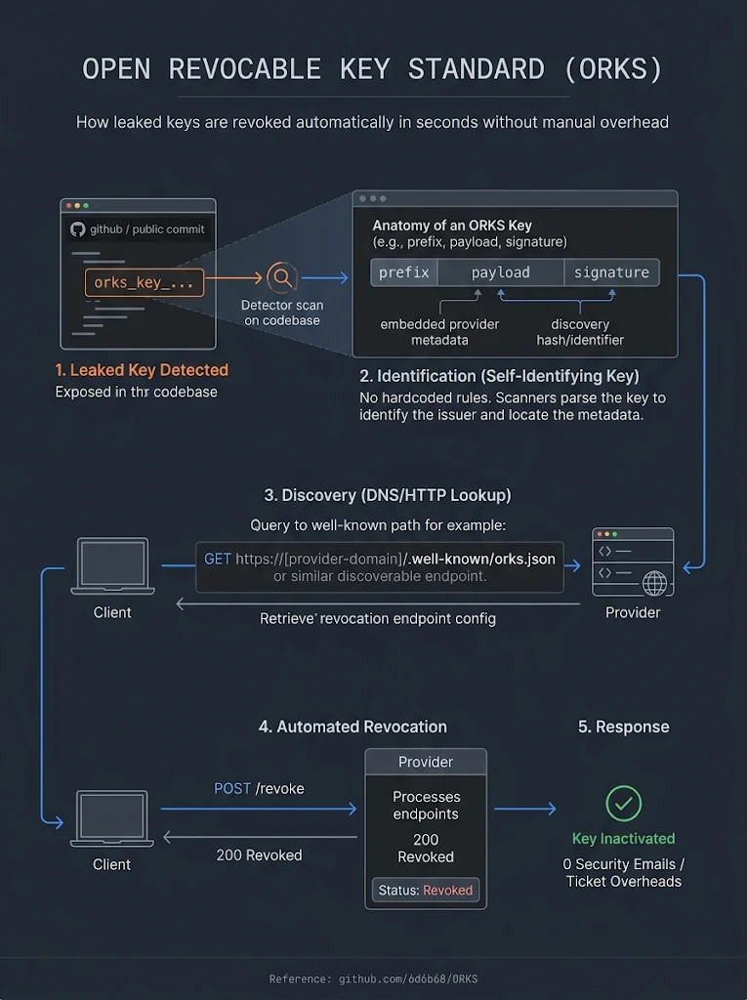

# ORKS
Open standard API Spec - ORKS (Open Revocable Key Standard)

<p align="center">
  
</p>

*Figure: end-to-end flow from leak detection to automated revocation. Illustrative — normative field names, paths and response codes are those in §3–§5 below.*


# Open Revocable Key Standard (ORKS)
 
**Draft v0.2 — Discussion Document** (November 2026; supersedes v0.1, September 2026)
Status: Pre-standard sketch, seeking feedback
Requirement keywords (MUST, SHOULD, MAY) per RFC 2119.

> Canonical source, discussion, and proposed changes live at **[github.com/6d6b68/ORKS](https://github.com/6d6b68/ORKS)** — open an issue or PR to weigh in. Background: [*This Key Will Self-Destruct*](https://www.securityweek.com/this-key-will-self-destruct-an-open-standard-for-revocable-api-keys/) (SecurityWeek, Sept 2026).
 
---
 
## 1. Abstract
 
ORKS defines an open convention for issuing API keys that are (a) attributable to their issuer by inspection, (b) revocable by anyone in possession of them via a discoverable endpoint, and (c) optionally subject to a **quarantine delay** that protects key owners from malicious or accidental revocation while still neutralizing leaked credentials quickly.
 
The goal: when a key is found in a public repo, paste site, or log file, any party — the owner, a scanner, or a good-samaritan researcher — can neutralize it in seconds, with zero human back-and-forth, without knowing anything about the issuer in advance.
 
## 2. Motivation
 
- OAuth 2.0 has RFC 7009 (token revocation) and OIDC Discovery. Plain API keys — the most commonly leaked credential class — have no equivalent.
- Today's leak response is manual: identify the provider, find a security contact, email, wait. Hours-to-days of exposure.
- GitHub's Secret Scanning Partner Program proves the model works (provider-registered patterns + revocation webhooks) but is proprietary, centralized, and invite-only. ORKS decentralizes it.
## 3. Key Format
 
### 3.1 Structure
 
```
orks_{issuer}_{secret}_{check}
```
 
| Segment | Description |
|---|---|
| `orks` | Fixed literal prefix identifying an ORKS-conformant key. Issuers MAY append a vendor tag (e.g. `orks-live`, `orks-test`). |
| `issuer` | The issuer's domain, base32-encoded (lowercase, no padding). Enables offline attribution. |
| `secret` | ≥ 128 bits of CSPRNG entropy, base62-encoded. |
| `check` | CRC32 of the preceding segments, base62-encoded. Eliminates scanner false positives; carries no security value. |
 
### 3.2 ABNF (informal)
 
```
orks-key   = "orks" [vendor-tag] "_" issuer "_" secret "_" check
vendor-tag = "-" 1*8(ALPHA / DIGIT)
issuer     = 1*64(base32-lower)
secret     = 22*86(base62)
check      = 6(base62)
```
 
### 3.3 Properties
 
- A scanner that finds a matching string can: validate the checksum offline, decode the issuer domain, fetch the issuer's discovery document, and act — all without a registry.
- The checksum MUST NOT be treated as authentication. Possession of the full key string is the only credential.
## 4. Discovery
 
Issuers MUST serve a JSON document at:
 
```
https://{issuer}/.well-known/api-key-config
```
 
Example:
 
```json
{
  "orks_version": "0.2",
  "issuer": "api.example.com",
  "revocation_endpoint": "https://api.example.com/orks/revoke",
  "introspection_endpoint": "https://api.example.com/orks/introspect",
  "security_contact": "mailto:security@example.com",
  "revocation_modes": ["immediate", "quarantine"],
  "quarantine_delay_seconds": 86400,
  "quarantine_restrictions": ["read_only", "rate_limited"],
  "supported_constraints": ["ip_allowlist", "expiry", "scopes", "mtls"],
  "documentation": "https://example.com/docs/api-keys"
}
```
 
Requirements:
 
- MUST be served over TLS with `Content-Type: application/json`.
- SHOULD be cacheable (`Cache-Control`) for at least 1 hour.
- The `security_contact` field gives responders a fallback channel, mirroring RFC 9116 (security.txt).
## 5. Revocation Endpoint
 
### 5.1 Request
 
```
POST /orks/revoke
Content-Type: application/json
 
{
  "key": "orks_nfxgg...._abc123",
  "mode": "quarantine",
  "reason": "found_in_public_repository",
  "evidence_url": "https://github.com/acme/app/blob/main/config.js#L14",
  "reporter_contact": "mailto:researcher@example.org"
}
```
 
- `key` (REQUIRED): the complete key string. Partial keys MUST be rejected — requiring the full secret means only parties who could already abuse the key can revoke it ("possession implies revocation right").
- `mode` (OPTIONAL): `immediate` or `quarantine`. If omitted, the issuer applies its advertised default. Issuers MAY ignore a requested `immediate` from unauthenticated callers and downgrade to `quarantine` (see §6).
- `reason`, `evidence_url`, `reporter_contact` (OPTIONAL): forwarded to the key owner in the notification.
### 5.2 Response
 
```
HTTP/1.1 200 OK
 
{ "status": "accepted", "mode_applied": "quarantine", "hard_revoke_at": "2026-07-04T18:00:00Z" }
```
 
- Issuers MUST return `200` with `"status": "accepted"` for both valid-and-processed keys **and** unknown/already-revoked keys, to prevent the endpoint from being used as a key-validity oracle. (`mode_applied` and `hard_revoke_at` MAY be synthesized for unknown keys.)
- The endpoint MUST NOT require authentication.
- Issuers MUST rate-limit aggressively (per-IP and global) and SHOULD require the checksum to validate before doing any database lookup, making bulk-guess attacks computationally useless.
## 6. Quarantine Delay (Optional Mode)
 
The quarantine mode addresses the primary objection to unauthenticated revocation: **a leaked key becomes a griefing vector** — an attacker who finds (or is given) a key could instantly break production. Quarantine converts "instant outage" into "supervised wind-down."
 
### 6.1 State Machine
 
```
ACTIVE ──(revoke: immediate)──────────────► REVOKED
ACTIVE ──(revoke: quarantine)──► QUARANTINED ──(timer expires)──► REVOKED
                                     │
                                     ├──(owner cancels + acknowledges)──► ACTIVE
                                     └──(owner expedites)──► REVOKED
```
 
### 6.2 Behavior in QUARANTINED state
 
On entering quarantine, the issuer:
 
1. **MUST notify the key owner immediately** via all registered channels (email, webhook, dashboard alert), including the `reason`, `evidence_url`, and time of hard revocation.
2. **SHOULD apply immediate restrictions** while the timer runs, chosen from its advertised `quarantine_restrictions` — e.g. force read-only scopes, drop rate limits to a trickle, block destructive/financial operations, log all usage with source IPs. This narrows the attacker's window even though the key still "works."
3. **MUST hard-revoke** when `quarantine_delay_seconds` elapses (advertised in discovery; RECOMMENDED default 24h, MUST NOT exceed 72h).
### 6.3 Owner controls
 
- **Cancel**: The owner MAY cancel quarantine through an authenticated channel (dashboard/API). Cancellation MUST require explicit acknowledgment of the leak evidence, and the issuer SHOULD strongly prompt rotation — canceling on a genuinely leaked key is almost always the wrong call, and the UI should say so.
- **Expedite**: The owner MAY convert quarantine to immediate revocation at any time.
- Repeated cancel-after-report cycles on the same key SHOULD trigger escalation (e.g. account security review).
### 6.4 Choosing a default mode
 
- Issuers SHOULD default third-party (unauthenticated) revocations to `quarantine`.
- Issuers SHOULD honor `immediate` when the request arrives through an authenticated owner channel.
- High-risk key classes (payment, admin) MAY be configured for immediate revocation always — the discovery document's `revocation_modes` communicates this.
### 6.5 Self-Revocation and Task-Scoped Keys
 
Autonomous holders — AI agents especially — often need a credential only for the duration of a task. ORKS supports treating revocation as the natural end of a key's life, not just an emergency response:
 
- Holders SHOULD revoke their own keys upon task completion by POSTing to the revocation endpoint with `"reason": "task_complete"`.
- Because the issuer cannot distinguish a legitimate holder from an attacker at the revocation endpoint, `task_complete` alone MUST NOT bypass the issuer's default quarantine policy. Instead, owners MAY opt in **at issuance** by minting the key with a `self_revoke: "immediate"` policy. Keys of this class are hard-revoked instantly on any possession-based revocation request — the owner has pre-declared that this credential is disposable and that availability-griefing is a non-concern for it.
- Issuers supporting this SHOULD advertise `"issuance_policies": ["self_revoke_immediate"]` in the discovery document.
- Orchestration frameworks SHOULD issue task-scoped keys with both `self_revoke: "immediate"` and a short `expiry`, so revoke-on-completion is the fast path and TTL is the backstop when an agent crashes before cleanup.
This gives agents least-privilege in the time dimension: a key found in a log after its task finished is already dead, and the revocation call itself doubles as an auditable "task released its credentials" event.
 
## 7. Introspection Endpoint (Optional)
 
```
POST /orks/introspect
{ "key": "orks_...." }
```
 
Returns minimal, non-sensitive state: `{"state": "active" | "quarantined" | "revoked" | "unknown"}` plus `hard_revoke_at` when quarantined. The full key MUST be required (anti-enumeration). Issuers MAY omit this endpoint entirely; scanners use it to prioritize findings.
 
## 8. Constraint Declarations
 
`supported_constraints` advertises which bindings the issuer can attach to keys at creation:
 
| Constraint | Meaning |
|---|---|
| `ip_allowlist` | Key valid only from declared CIDRs |
| `expiry` | Mandatory max TTL supported |
| `scopes` | Fine-grained permission subsets |
| `mtls` | Key bound to a client certificate |
| `referrer` | Browser-context origin restriction |
 
This turns key hygiene into an auditable procurement question: "does this vendor support IP-pinned keys?" is answerable with one GET.
 
## 9. Security Considerations
 
- **Revocation DoS / griefing**: mitigated by quarantine delay (§6), rate limiting, and full-key requirement. Vault/OpenBao chose to authenticate their proof-of-possession revocation endpoint for exactly this reason; ORKS instead keeps the endpoint open (so strangers can act on leaks) and absorbs the risk with delay + restriction.
- **Enumeration**: uniform `200 accepted` responses, full-key requirement, checksum-first validation. For issuers that accept opaque (non-ORKS) tokens at the revocation endpoint (§11.13), there is no checksum to pre-filter on, so rate limiting and uniform responses carry the anti-enumeration load alone; such issuers SHOULD enforce a minimum token length matching their own format and MAY apply stricter per-IP limits to opaque submissions than to checksum-valid ORKS keys.
- **Attacker-visible prefixes**: self-identifying keys are also easier for attackers to grep. This trade is accepted: attackers already fingerprint keys by entropy and context; identifiability primarily accelerates defenders and automated scanners. As of late 2026 this objection is weaker still: GitHub's push protection now catches secrets with *no* known pattern via a context-aware classifier, so a prefix buys attackers little detection value they didn't already have. The prefix's value is attribution and routing — getting a found key to the right revocation endpoint — not detection.
- **"Quarantined but still live" is a failure mode, not a safe state**: Truffle Security's 2026 re-verification found 929 leaked AWS keys still working that AWS had already placed under its compromised-key quarantine policy, some more than three years earlier. ORKS quarantine therefore has a mandatory hard-revoke at timer expiry (§6.2, MUST NOT exceed 72h); an issuer MUST NOT implement quarantine as an indefinite restricted state.
- **Delay window is attacker window**: if the leak is real, quarantine leaves a restricted-but-live key for up to the delay period. §6.2's restriction requirement exists to shrink this; issuers with low tolerance should advertise and use `immediate`.
- **Notification channel compromise**: if the attacker controls the owner's email, they could cancel quarantine. Cancellation therefore requires the authenticated dashboard, not an email link.
## 10. Prior Art
 
RFC 7009 (OAuth token revocation), RFC 8615 (well-known URIs), RFC 9116 (security.txt), OIDC Discovery, GitHub Secret Scanning Partner Program, GitHub token prefixes + CRC32 checksums, Stripe key prefixes, Vault/OpenBao PoP certificate revocation.

Added for v0.2 (see `NOTES.md` for details and links):

- **ASF Scannable Secret Token Standard (draft, 2026)** — `asf_{component}_{27×base62}{6×base62 CRC-32}`; a fully specified checksum with test vectors. ORKS adopts its CRC-32 encoding (§11.6).
- **Truffle Security Secrets Revocation Program (Nov 2026)** — issuer-side revocation endpoint or webhook with a 14-day revoke-or-explain SLA; 16 issuers at launch. Proprietary and scanner-centric, but the closest deployed analogue to §5 (§11.7).
- **OpenID CAEP Interoperability Profile 1.0 draft 01 (Jul 2026)** — standardizes the `credential-change` event ORKS maps quarantine/revoke transitions onto (§11.2, §11.8).
- **Demir et al., "Keys on Doormats: Exposed API Credentials on the Web" (CCS 2026)** — 11.9M-hostname measurement; distinctive key formats verify at much higher rates; notification yields removal far more often than revocation (§11.9).
- **RFC 8959 (`secret-token` URI scheme)** — a format-agnostic marker that a string *is* a secret. Complementary to ORKS, which says *whose* secret and how to revoke it (§11.12).
- **RFC 5234 / RFC 7405 (ABNF, case-sensitive strings)**, **RFC 4648 (base encodings)**, **KSUID** — referenced by the §11.14 format tightening.
 
## 11. Open Questions and Proposed Resolutions
 
### 11.1 Issuer segment: raw domain vs. base32
 
**Proposed: raw lowercase domain.** Base32 was solving a charset problem domains don't actually have — DNS labels are already lowercase alphanumerics, hyphens, and dots, all of which are safe in header values and shell strings, and none of which collide with the `_` delimiter (underscores never appear in hostnames). Raw domains make keys human-attributable at a glance (`orks_api.stripe.com_...`), which matters during incident response when a responder is staring at a log line, not running a decoder. Internationalized domains MUST be encoded as punycode (their on-the-wire DNS form). The checksum segment already covers integrity. Resolution: v0.2 drops base32; the `issuer` segment is the raw punycode-normalized domain.
 
### 11.2 Quarantine event webhooks
 
**Proposed: adopt Shared Signals, don't invent one.** v0.1 deliberately requires notification without specifying transport. For v0.2, rather than defining a bespoke webhook format, ORKS should profile the OpenID Shared Signals Framework (SSF) and CAEP, which already standardize signed Security Event Tokens for exactly this class of signal — CAEP's credential-change event maps almost directly onto quarantine/revoke transitions. Issuers advertise an SSF transmitter in the discovery document (`"event_stream": "https://..."`); SIEMs and agent orchestrators subscribe with existing SSF receivers instead of custom integrations. Plain HTTPS webhook delivery remains a MAY for issuers that don't want the SSF machinery, but the event payload schema is shared either way.
 
### 11.3 Signed key variant (offline constraint verification)
 
**Proposed: out of scope; keep as a future optional profile.** A JWT/PASETO-style key would let gateways verify constraints without calling introspection, but it triples key size, invites the classic mistake of treating key contents as trusted policy after revocation, and — most importantly — breaks the "thirty seconds to integrate" property that explains why plain keys dominate in the first place. ORKS's core value is a kill switch for the keys the world actually uses; constraint enforcement stays issuer-side. If demand materializes, a separate `orksj_` profile can be layered on later without touching the base spec. Resolution: rejected for core; parked as an extension.
 
### 11.4 Registry vs. convention for `reason` codes and constraint names
 
**Proposed: a lightweight public registry with an escape hatch.** Pure convention guarantees collisions ("does `ip_allowlist` mean CIDRs or exact IPs?"); a full IANA registry is too heavy for a v0.x spec and would stall momentum. Middle path: a registry file in the spec's public repository, amended by pull request under expert review — the same lightweight model that has kept the well-known URI and security.txt ecosystems coherent. Unregistered experimental values MUST use an `x-` prefix (`x-vendor_geo_fence`) so parsers can distinguish standard from private semantics. If ORKS later goes through the IETF, the repo registry migrates to IANA wholesale. Resolution: repo-based registry seeded with the §5.1 reason codes and §8 constraint names.

### 11.5 Granular identifiers for large organzations
 
**Proposed: subcomponents for identifiers** Ability to drill down into business units within the same organization to help with identification (input from speakeasy.com)


### 11.6 Checksum algorithm: specify it exactly

**Proposed: adopt the ASF scannable-token CRC-32 encoding verbatim, with published test vectors.** v0.1 says "CRC32 of the preceding segments, base62-encoded" and leaves polynomial, input bytes, digit order and padding implicit — enough ambiguity that two independent scanners could disagree on a valid key. The Apache Software Foundation's draft token standard (`asf_{component}_{27×base62}{6×base62}`) has already nailed this down, and sharing one validator across both formats is worth more than any marginal design freedom. Resolution for v0.2:

- Input: the ASCII bytes of everything before the final `_` (i.e. `orks[-tag]_{issuer}_{secret}`), not decoded binary. *Note: this deliberately differs from ASF, which checksums the entropy segment only; ORKS covers the issuer so a corrupted or tampered issuer segment also fails the check. A shared validator needs one branch on the prefix to pick the input span.*
- Algorithm: IEEE 802.3 CRC-32 — reflected polynomial `0xEDB88320`, init `0xFFFFFFFF`, final XOR `0xFFFFFFFF` (what `zlib.crc32` computes).
- Encoding: base62 (`0-9A-Za-z`), most-significant digit first, left-padded with `0` to exactly 6 characters. The maximum CRC-32 encodes as `4gfFC3`, so the first checksum character is always `0–4`; scanners MAY use that as a cheap pre-filter.
- Reference vector (ASF, checksum over 27 ASCII `0`s): `2MvMGi`. ORKS vector: `orks_api.example.com_4Zq9mLpX2vR7tK1sB8nW3cD6fH0jY5aE` → check `15KzgI`.
- Secret length: RECOMMENDED 27 base62 characters (~160 bits), matching ASF; the §3.2 range (22–86) stays as the MUST.
- Character set stays within the `token68` production (RFC 9110 §11.2) so keys can be carried in DPoP / `Authorization` headers unmodified.

### 11.7 Report endpoint: a notify-only tier below quarantine

**Proposed: add an optional `report_endpoint` with an advertised SLA, as a standard on-ramp for issuers who will not open an unauthenticated kill switch.** Truffle Security's revocation program (Nov 2026) offers issuers exactly two integration modes — "we call your revocation endpoint" or "we webhook you and you revoke within 14 days" — and 16 issuers signed up at launch. The second mode is what most issuers will accept first. ORKS can standardize it so the webhook isn't bespoke per scanner:

```json
"report_endpoint": "https://api.example.com/orks/report",
"report_sla_seconds": 1209600
```

- Same request body as §5.1. Same uniform `200 accepted` (anti-enumeration). No authentication required.
- The issuer commits to revoke, quarantine, or respond with a documented reason within `report_sla_seconds` (RECOMMENDED ≤ 14 days, matching current industry practice).
- An issuer MAY serve `report_endpoint` without `revocation_endpoint` during adoption; the discovery document makes which tier it offers auditable with one GET. Issuers SHOULD treat this as a stepping stone to quarantine, not a destination — the data in §11.9 shows notification alone rarely produces revocation.

### 11.8 CAEP mapping for quarantine/revoke events (resolves §11.2)

**Proposed: map ORKS state transitions onto CAEP `credential-change` per the CAEP Interoperability Profile 1.0 (draft 01, July 2026).** The profile makes `credential-change` one of three conformance use cases, requires receivers to handle every `change_type`/`credential_type`, and requires a non-empty `reason_admin`. Mapping:

| ORKS transition | CAEP event | Fields |
|---|---|---|
| ACTIVE → QUARANTINED | `credential-change` | `change_type: "update"` (restrictions applied; the credential is still live), `reason_admin: {"en": "quarantined: <reason>"}`, plus ORKS event claims `orks_state: "quarantined"`, `orks_hard_revoke_at`, `orks_evidence_url` |
| QUARANTINED → REVOKED, ACTIVE → REVOKED | `credential-change` | `change_type: "revoke"`, `reason_admin: {"en": "<§5.1 reason>"}`, `orks_state: "revoked"` |
| QUARANTINED → ACTIVE (owner cancel) | `credential-change` | `change_type: "update"` (restrictions lifted), `reason_admin: {"en": "quarantine cancelled by owner"}`, `orks_state: "active"` |

`reason_admin` is a language-tag-keyed object per CAEP and carries human text only; machine-readable ORKS fields travel as separate `orks_*` claims in the event payload. Receivers that don't understand them ignore them (SET extensibility). `revoke` is used only when the credential actually stops working — a receiver MUST be able to rely on that.

Gaps to raise with the OpenID Shared Signals WG: (a) `credential_type` has no value for API keys — propose `api_key`; (b) the interop profile mandates `email` and `iss_sub` subject identifiers, neither of which fits a bearer key — propose an `opaque` subject whose `id` is the base64url SHA-256 of the full key string, which identifies the key to its owner without disclosing it. Until adopted, issuers SHOULD use `opaque` with that construction and document it in discovery (`"event_subject_format": "sha256-key"`). Plain HTTPS webhook delivery remains a MAY, carrying the same signed SET payload (RFC 8417; the interop profile requires RS256 ≥ 2048-bit).

### 11.9 Publishable (intentionally client-side) key class

**Proposed: add a `publishable` key-class marker so scanners can deprioritize keys that are meant to be exposed.** The CCS 2026 web-exposure study found 84% of live web credentials in first-party resources, 84% in JavaScript files (62% of those in build bundles), and that site operators often believed the key was safe to ship. Stripe's `pk_`/`sk_` split is the working precedent. Resolution: issuers MAY issue keys with vendor tag `orks-pk` (within the existing `vendor-tag` grammar) and MUST declare in discovery which tags are publishable:

```json
"publishable_tags": ["pk"]
```

A publishable key MUST be origin- or referrer-bound (`referrer` constraint, §8), rate-limited, and non-destructive. Scanners SHOULD report publishable keys at informational severity only. Revocation semantics are unchanged — a publishable key is still revocable by possession.

### 11.10 Agents MUST NOT cancel their own quarantine

**Proposed: an explicit norm for autonomous holders.** §6.5 lets agents self-revoke on task completion. The inverse must be ruled out: an agent that holds a quarantined key, or has dashboard credentials, MUST NOT cancel or extend a quarantine without a human in the loop — the same rule GitHub now applies to agents bypassing push protection. Cancellation is a human acknowledgment of leak evidence by definition (§6.3). Orchestration frameworks SHOULD treat an ORKS quarantine notification as a hard stop for the affected task and surface it for human review rather than retrying with the restricted key.

### 11.11 Motivation data to carry into v0.2 (§2)

Measurements published since v0.1 that make the §2 case concretely:

- Truffle Security (2026): 81% of valid keys reported to owners/issuers in 2025 were still usable six months later; of 64,024 leaked AWS keys re-verified in Aug 2026, 88% were still active, median age ~5 years, 768 with full admin rights.
- Demir et al., CCS 2026: exposed credentials stayed public ~12 months on average; after notification, removals fell ~50% by day 14 but revocations only ~26% — removal without revocation is the common outcome.
- The same study: services with distinctive key formats verify at far higher rates (Telegram 85%), while GitHub's broad pattern produced most false positives — direct support for §3's self-identifying format plus a validated checksum (§11.6).
- GitHub (Oct 2026): push protection now blocks Anthropic API keys by default and runs a context-aware classifier that catches unpatterned secrets — detection is no longer the bottleneck; attribution and revocation are.

### 11.12 Relationship to RFC 8959 (`secret-token:` URI scheme) — issue #1

**Proposed: ORKS keys MAY be carried as `secret-token:` URIs; the bare key is the canonical form.** RFC 8959 marks that a string *is* a secret without knowing its format; ORKS says *whose* it is and how to neutralize it. The two compose, since every character an ORKS key can contain (including the `.` and `-` of a raw-domain issuer, §11.1) is a `pchar`. Resolution:

- The bare key (`orks[-tag]_{issuer}_{secret}_{check}`) is canonical. The checksum covers the bare key only (§11.6) and never the scheme prefix.
- Holders MAY serialize a key as `secret-token:orks_...` in config files, logs and transport where a generic secret marker is useful. Issuers SHOULD accept either form at `/revoke`, `/report` and `/introspect`, and MUST strip a leading `secret-token:` (case-insensitive scheme per RFC 3986 §3.1) before checksum validation and lookup. "The complete key string" in §5.1 means the bare key after stripping.
- Scanners SHOULD apply the same strip-then-validate rule, and SHOULD treat the URI form as a match of equal confidence — the checksum still discriminates true positives.
- Issuers MUST NOT emit the URI form as the key's primary representation in dashboards or API responses; it is a carriage convention, not a key format.

### 11.13 Opaque (non-ORKS) tokens at the revocation endpoint — issue #2

**Proposed: allow discovery and revocation when the issuer is known out of band, so existing issuers can adopt the endpoints before (or without) adopting the key format.** Most tokens in circulation carry no machine-readable issuer, yet the reporter often knows the issuer from a hostname, SDK import or config key beside the leak. Wrapping legacy tokens inside the `secret` segment is impractical (length inflation, hides the token from existing scanners, breaks the CSPRNG semantics, and the issuer still has to accept the wrapped form). Resolution:

1. The reporter identifies the issuer domain by any means and fetches `https://{issuer}/.well-known/api-key-config` as in §4.
2. The discovery document advertises what the endpoints accept:
   ```json
   "accepted_key_formats": ["orks", "opaque"]
   ```
   `orks` is implied when the field is absent. An issuer MAY list `opaque` only — i.e. publish discovery and revocation for its current key format with no `orks_` keys in circulation.
3. The reporter POSTs the token *as issued* to `revocation_endpoint` (or `report_endpoint`, §11.7). All of §5 applies unchanged: full token required, no authentication, uniform `200 accepted`, quarantine semantics per §6.
4. Checksum-first validation (§5.2) applies to ORKS-format submissions only. For opaque submissions the issuer MUST still reject partial tokens, SHOULD enforce its own format's length and alphabet before any lookup, and SHOULD rate-limit opaque submissions at least as aggressively as ORKS ones (§9).
5. Issuers accepting `opaque` SHOULD also publish the key *patterns* they issue, so scanners can route without the ORKS prefix:
   ```json
   "key_patterns": ["^sk_(live|test)_[0-9A-Za-z]{24,}$"]
   ```
   This is the open equivalent of a GitHub secret-scanning partner registration: pattern + endpoint, discoverable from the domain, no gatekeeper.

This is the lowest-cost on-ramp in the spec — an issuer with an existing key format adopts ORKS by publishing one JSON file and one endpoint, and gains quarantine, reporting and CAEP events (§11.8) for keys it already issues. Migration to the self-identifying format (§3) becomes a second, independent step.

### 11.14 Key format: lengths, alphabets, encoding — issue #3

**Proposed: tighten §3 so two independent implementations cannot disagree on whether a string is a valid ORKS key.** Builds on §11.1 (raw domain) and §11.6 (checksum). Resolution:

- **Secret length is bounded.** Keep `22*86(base62)` in the ABNF and state it in prose: the secret encodes between 128 and 512 bits of CSPRNG output. 27 characters (~160 bits) is RECOMMENDED (§11.6). A bounded range gives implementers fixed storage, header and regex sizes.
- **Generation is per-character, not integer-encoded.** Each secret character is drawn independently and uniformly from the base62 alphabet. This avoids the ~13% of 128-bit integers that would base62-encode to fewer than 22 characters, needs no padding rule, and matches the ASF token standard. The checksum, by contrast, *is* an integer encoding and is zero-padded to 6 characters (§11.6) — the two rules are stated separately on purpose.
- **Alphabets are defined explicitly** (none are core ABNF rules, RFC 5234 App. B):
  ```abnf
  base62     = DIGIT / %x41-5A / %x61-7A      ; 0-9 A-Z a-z, digit values 0..61 in that order
  ```
  Base32 is dropped with §11.1, so `base32-lower` is removed rather than defined.
- **Issuer is a hostname.** Replace `issuer = 1*64(base32-lower)` with the LDH hostname syntax of RFC 1123 §2.1 (labels `%x30-39 / %x61-7A / "-"`, max 63 bytes each, total ≤ 253 bytes, lowercase, IDNs as A-labels per RFC 5891). `_` never appears in a hostname, so the delimiter stays unambiguous. The 64-character cap in v0.1 was too short for either encoding.
- **Literal strings are case-sensitive.** `orks` and the vendor tag are written with `%s` (RFC 7405) so `ORKS_` is not a valid prefix.

Resulting v0.2 ABNF:
```abnf
orks-key   = %s"orks" [vendor-tag] "_" issuer "_" secret "_" check
vendor-tag = "-" 1*8(DIGIT / %x61-7A)
issuer     = hostname                        ; RFC 1123 LDH, lowercase, A-labels, <= 253 octets
secret     = 22*86(base62)                   ; per-character uniform CSPRNG
check      = 6(base62)                       ; CRC-32 per §11.6, zero-padded
base62     = DIGIT / %x41-5A / %x61-7A
```
